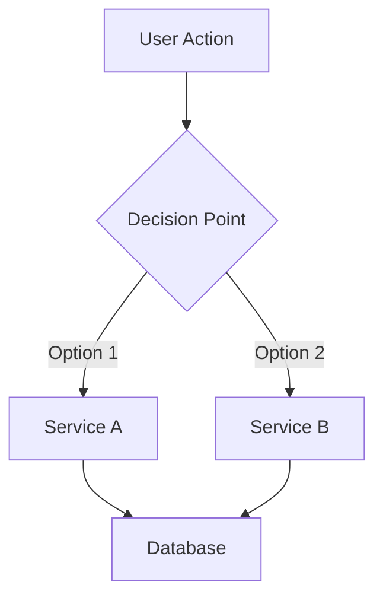

# TDD Writer

Draft Technical Design Documents for staging up large or complex projects. A TDD is a communication tool: a reader who has never seen the work should be able to read it start to finish and come away understanding **what** you're proposing, **why**, and **how** it will be built. It is not a form to fill in, and it is not a checklist with the prose removed.

**REQUIRED BACKGROUND:** Invoke `/flagrare:write-docs` before drafting. This skill owns *what a TDD must cover and how to verify it*; write-docs owns *how to make the prose readable*. The single most common failure of an AI-drafted TDD is the "medicine sheet", every section flattened into terse bullets, no causality, nothing a human wants to read. The craft layer in write-docs is the antidote, and the section "Writing the document" below applies it specifically to TDDs. Read both; do not skip the handoff.

---

## When to Use

- Projects estimated at 2+ weeks
- Complex features with multiple components
- Architectural changes affecting multiple services
- Features requiring cross-team coordination
- User says "write a TDD", "design doc", "technical design"

---

## No Assumptions Policy

**Never assume, imply, or hallucinate ANY technical information.**

Every piece of information about architecture, code, systems, services, data models, and APIs must be:
1. Verified by reading actual source code
2. Confirmed via MCP tools (Jira, Confluence, Notion, Figma)
3. Double-checked against the actual codebase

### When Information is Unknown

Use these markers:

```
[UNKNOWN: Brief description of what's missing]
[NEEDS VERIFICATION: What needs to be checked and where]
[TBD: Decision pending - who needs to decide]
```

### Before Writing Any Technical Detail

1. **Service names** - search codebase, verify service exists
2. **API endpoints** - read actual proto files or route definitions
3. **Database tables** - find actual schema/migrations
4. **Data models** - read actual model/entity files
5. **Business logic** - read actual implementation code
6. **Dependencies** - check package.json, build.gradle, requirements.txt

---

## Workflow

### Phase 1: Gather Context

Before drafting, collect and verify information from all available sources.

**Step 0: Read the team's own TDD guidance and template, fresh**

If the team has a TDD template or a guidance page, find it and read the current version now, even if you used it last week. Templates change between drafts, and a draft can quietly drop a section the template asks for (field-tested: a TDD went to review without the template's Key decisions section, and the same week the template made Testing its own required section). The team's sections and order win over the template below; use this skill's template as the checklist of what each of their sections must cover. When their guidance names the bar for context (who the reader is, what they must learn), quote it to yourself and hold the draft to it.

**Step 1: Fetch External Context via MCP**

Jira/Linear ticket (if provided):
- Fetch full ticket details: description, acceptance criteria, linked issues
- Walk the parent chain (epic, initiative) for broader context
- Check remote links for Confluence, Figma, Notion references

Confluence/Notion docs (if referenced):
- Fetch related docs, DACIs, existing tech notes
- Search for related TDDs in the same area

Figma designs (if linked):
- Get design context, component structure
- Capture screenshots for visual reference

**Step 2: Explore Existing UI (if modifying an existing system)**

If the feature modifies an existing interface, explore the current state:
- Navigate to the relevant pages
- Document current UI layout, components, user flows
- Note current limitations and UX issues
- Identify patterns to maintain or improve

**Step 3: Analyze Codebase (required)**

Read actual code before writing technical details:
- Search for affected services, read entry points
- Find existing data models, database migrations
- Check proto files for message definitions
- Understand current architecture: API routes, service communication
- Review related code for patterns
- Find similar features for reference

**Step 4: Mark All Unknowns**

After gathering, explicitly list what could NOT be verified:
- Missing schema information
- Unclear service boundaries
- Unconfirmed business logic
- Pending decisions

### Phase 1.5: Set the bet

Before drafting, run `/flagrare:measure-impact` with `before <ticket, doc or initiative link> full called by /flagrare:tdd-writer`. Use what it returns in two places: the **For product** paragraph at the top of the Introduction (the bet, the number it should move with today's value and its source, how sure we are, what is out of scope), and the Analytics or Observability section (how the change will be tracked). When it reports a baseline as unknown, keep that visible in the doc ("baseline unknown: <how to get it>") instead of inventing a number.

### Phase 2: Draft Structure

The template below is a **coverage checklist for the author, not a layout for the reader**. It lists what a good TDD considers. It does not mean each heading gets three bullets and a code block. As you fill it, follow one rule above all others: **write each section as prose a colleague could read aloud.** Reach for a list or table only when the content is genuinely parallel and order-independent, a roster of endpoints, a t-shirt-size scale, a test matrix. The moment a "list" has bullets that depend on each other (this happens, *then* that, *because* of the other), it's a paragraph wearing a list costume. Write the paragraph.

Drop sections that don't apply rather than filling them with "N/A" noise. Mark ANY unverified information with the markers above.

```markdown
# TDD: [Initiative Title]

**Author:** [Name]
**Team:** [Team/Squad Name]
**Status:** IN REVIEW | GO | NO GO

**Links:**
- Ticket: [link]
- Designs: [link]
- Docs: [link]

---

## Introduction

### For product
[3 to 5 plain sentences a product manager can read without the rest of the doc: what changes for users, the bet from /flagrare:measure-impact (the number it should move, today's value and its source, how sure we are), and what is out of scope.]

### Context
[Short paragraphs, one idea each, in this order (see "Writing the context" in Phase 3):
1. What exists today, in plain words. Define the doc's key terms here, above all the
   split the design turns on (two kinds of customer, two paths, two services).
2. The problem, made concrete: one real case (a real customer, screen or record),
   not an abstraction like "the two can disagree".
3. Why now: what changed since the last decision (a dependency shipped, a deadline,
   new data).
4. Impact: who gains, in one plain sentence. The bet and its number live in For product,
   so point to it instead of repeating it.
5. Links for depth, instead of re-explaining earlier docs.
6. Before/after screenshots for any change a user sees.]

### Goals and non-goals
[Goals: what done looks like, ideally measurable. Non-goals: things a reviewer would
reasonably expect this work to do, but it won't, each with one reason or a pointer to
who owns it. A list is right here: the items are parallel.]

### Current Flow (if modifying existing system)
[Document the existing UI and user flow.]

### Proposed Solution
[2-3 sentences: How do you plan on solving it?]

### Long Term Vision
[How does this bring us closer to the team's long-term goals?]

---

## Decision Record

- **Driver:** [Author]
- **Approver:** [EM or senior IC with domain expertise]
- **Contributors:** [Your team, affected teams]
- **Informed:** [Engineering, PM, relevant stakeholders]

---

## Phase 1

### LOE (T-Shirt Size)

| Size | Time |
|------|------|
| XS | 1-2 days |
| S | 1 week |
| M | 2 weeks |
| L | 4 weeks |
| XL | 4+ weeks |

**This phase:** [SIZE]

### External dependencies & impact

[Prose. Who else is affected and how? Name the teams that depend on this or whose
systems you touch, the vendors (with cost) you're adding, the libraries or internal
services you'll lean on, and the consequence of each. A reader should learn not just
*that* Team X is involved but *what they have to do because of this work*.]

### Concepts

[Prose. Introduce each new idea or model and, crucially, how they relate. This is
where causality lives, "an Order owns many LineItems, and a LineItem can't outlive
its Order", so resist turning it into a glossary of disconnected terms.]

### System architecture, data model & APIs

[The technical heart. Walk the reader through the design as a story: the shape of the
data, what flows where, and the one or two decisions that everything else hangs on.
Lead with the decision and its reason, then show the artifact.

- **Data model:** Describe in prose what's changing and why, then show the actual
  schema/migration. A reader should understand the *semantics* before they read the
  column list. Reserve tables for the column inventory itself.
- **APIs:** Say what the client experiences differently and why you chose this shape,
  then include the real endpoint/proto/GraphQL definition inline (verified against
  source). A list is right for the *roster* of endpoints; prose is right for the *why*.
- **Business logic:** Explain non-trivial logic as a narrative of what happens and
  when. Number the steps only when they're a true sequence. Call out load, response,
  and caching considerations where they bite, not as a trailing bullet dump.]

### Testing

[One or two sentences on the testing strategy, what gives you confidence this is
correct, then the matrix. The table is genuinely parallel data, so a table earns its
place here. Follow `/flagrare:testing-philosophy`: integration-heavy, behavior over
implementation, and, for any user-facing flow, at least one end-to-end test of the
critical happy path (a browser journey, a running-service HTTP test, a CLI subprocess,
or a public-API consumer, depending on the surface). "Mostly integration" is not "skip
e2e."]

| Scenario | Type | Data Considerations |
|----------|------|---------------------|
| [scenario] | unit/integration/e2e/manual | [special data] |

**What won't be tested:** [Prose. State the exclusions and *why* they're acceptable.]

### Localization
[Prose, if applicable. Translation strategy and what triggers it.]

### PII
[Prose. New PII fields? PII persisted outside the primary database? Name the field and
the handling, not just "yes".]

### Observability & alerting
[Prose. What new signal will exist, and, more importantly, what question each
metric/dashboard/alert answers when something goes wrong.]

### Security
[Prose. Auth, permissions, and any vulnerability surface this opens or closes, with
the mitigation in the same breath.]

### Analytics
[Prose. New or modified events and where they land, framed by what decision the data
supports.]

### Rollout strategy
[Prose. Walk through how this reaches production, dry run, stealth mode, feature
flags, gradual percentages, as a sequence with reasons, not a checklist of toggles.
The reader should understand the *risk posture*, not just the mechanics.]

### Post-deployment monitoring
[Prose. How will we know it's working? Name the queries/dashboards and who watches
them, so a reader could verify success themselves.]

### Risks
[Prose. Each known risk paired with its mitigation in the same sentence or paragraph.
A risk listed without a mitigation reads as an unanswered worry.]

### Documentation
[Prose. What docs need to exist or change, and for whom.]

### Key decisions
[The calls with real trade-offs that reviewers must judge in the gate. For each one:
the decision as a plain sentence ("We save the photo inside the item save, not
in a separate call"), the options, the pick and its reason, and what it costs. This is
not Open questions (still undecided) and not every resolved detail (state those once,
in the flow). New infrastructure, a new dependency, a change users will notice on day
one and anything that departs from the team's usual tools belong here.]

### Open questions
- [ ] [Genuinely open question, a real fork, not a placeholder]
- [ ] [Another, if any]

### Alternative solutions
[Prose. The options you considered and *why you discarded them*. This is one of the
most-read sections in any TDD, reviewers come here first to check you weren't naive, 
so give each alternative a fair sentence and an honest reason it lost.]

---

## Phase 2
[If applicable]

## Future Work
[Deferred items]

```

**Verification (a drafting artifact, NOT a section of the shipped TDD).** While drafting, keep a private checklist of what you verified and what you couldn't, sources checked (ticket, docs, code files, proto, schemas) and information gaps (`[UNKNOWN]`, `[NEEDS VERIFICATION]`, `[TBD]`). This keeps you honest and tells you what's still unproven. It is scaffolding for the author, so **strip it from the document you present.** A reader answering what/why/how does not need your sources list; genuinely-open decisions live in Open Questions, not a gaps dump. (Earlier versions of this skill shipped a "Verification Summary" section in the doc, that was wrong; it is a checklist you run, not content you publish.)

### Phase 3: Writing the document

This is where TDDs live or die. You've gathered verified facts; now you have to turn
them into a document a busy senior engineer will actually read. The craft layer is in
`/flagrare:write-docs`, invoke it, but here is how its principles land in a TDD.

**Write for the reader who needs to know, not for yourself.** By the time you write, you know how every piece works and what the plan is. The reader knows neither. The usual failure is a section written from the code outward: method names, flags and edge-case rules, with the one sentence that says what the section is for left out, because it felt too obvious to you. Before each section, name the reader's question to yourself ("why do we need a URL at all?", "where does this value come from?"). Then open the section with the answer, stated plainly, not with the question. Only then name the code. Test it: hide every function, table and field name in the section. If what's left doesn't tell a newcomer what happens and why, the section is written for you.

Field-tested the hard way: a section about showing item photos opened with which reads add a join and which helper builds the URL, then listed two rules about source values. It never said that the page needs a full image URL and the database stores only an id, which is the whole reason the section exists. The reviewer couldn't follow it until that framing came first, with a diagram of the request on top.

**Review fixes erode context, so reread the whole section after each one.** A review round changes one sentence at a time, and each change makes sense on its own. Over a few rounds, the framing sentences get cut or left behind, and a rule ends up with no "why" around it. After every edit, read the whole section again as a newcomer, top to bottom, before you call it done.

**Lead each section with the reader's situation, not the section's topic.** Compare
*"This section describes the data model changes."* (metadata, it has done zero work)
with *"Orders currently can't be partially refunded because the schema models a refund
as a single boolean. We're replacing that with a refund ledger."* The second sentence
tells the reader where they are and where you're taking them. The opening line of every
section should state a conclusion, name a problem, or ask a question.

**Writing the context.** The context section is the one reviewers judge everything
else by, and the one AI drafts get most wrong: they name a metric and a gap, then rush
to the mechanism. The order above draws on well-regarded design doc practice (Google's design docs, the
Rust RFC template, Kubernetes KEPs, Python PEPs): the starting point with terms defined,
a concrete problem before any solution, then impact and scope. "Why now" comes from the
RFC habit of opening with what changed since the last decision, and the screenshots
come from team TDD guidance.
The research is in
[`docs/research/2026-11-24-design-doc-context-sections.md`](../../../../docs/research/2026-11-24-design-doc-context-sections.md).
Four checks catch most failures:

- **A real case, not an abstraction.** "Products are text only" is a fact. "A seller's
  page lists 40 products with no photos, while the seller next to them shows a photo
  on every one" is a problem a reviewer can feel. Take the case from real data, not a toy.
- **"Why now" is the reason, so say it as the reason.** If a dependency just shipped
  and that is what makes the work possible or urgent, it opens a paragraph. It does
  not sit inside a storage or architecture paragraph as a side fact.
- **Impact says who gains, plainly.** "The main metric is X" names a number, not a
  reason. "Photos help buyers choose, and sellers earn per order" is the reason, in one
  sentence. Say it once and move on: this is a rationale, not a pitch.
- **Background facts, not mechanics.** Context says what exists and what is wrong.
  How the services talk, counts from production and field names belong in the flows.
  If a sentence only makes sense after the proposal, move it after the proposal.

Test the finished section on a new hire who knows the stack but not this product:
after reading only the context, can they say what is wrong today, for whom, why now,
and what this doc will and won't do? If not, the context failed, not the reader.

**Prose carries causality; lists flatten it.** A TDD is mostly *because* and *so that*
and *before*, exactly the relationships a bullet list erases. When you catch yourself
writing a list whose items depend on each other, you've found a paragraph. Keep lists
for the genuinely parallel: a roster of endpoints, a t-shirt scale, a test matrix, a
checklist of sources verified. (This is the single biggest lever against the "medicine
sheet" feel the operator complained about.)

**Put context at the point of need.** The first time a reader meets `client_secret` or
`OrderProjection` or a service name, define it inline in the same sentence, not in a
glossary, not three sections up. The reader who knows skips it; the reader who doesn't
is rescued exactly where they got lost.

**Voice and tone.** Use "We will…", conversational but precise. Be direct about scope
and limitations; a TDD that hides its gaps loses reviewer trust faster than one that
names them. Keep the voice the same throughout; let the tone tighten in the dense
technical sections and warm slightly in the context and vision.

**Diagrams.** A good diagram replaces three paragraphs of prose, so prefer Mermaid for
any non-trivial flow or architecture:



Color-code consistently, yellow/maize for existing architecture, blue for new, so a
reader can see the boundary of the change at a glance. When you show alternatives in a
diagram, mark the chosen path. Reference exact, verified file paths and show directory
layout for new components, but do it in service of the narrative, not as a standalone
inventory.

**Show what you name.** Every existing screen, service or file the TDD mentions gets a
link at first mention (code pinned to a commit) and every screen gets a cropped dev
screenshot with a caption that says what to look at. A proposed UI gets a clickable
mockup, and code citations go in collapsible toggles. `/flagrare:write-docs` ("Show
what you name") has the full set of moves.

### Phase 4: Review Before Presenting

**Do not end your turn the moment the draft is assembled.** A complete-looking TDD reads as "done," but the craft pass (Phase 3 / `/flagrare:write-docs`) and this review still have to happen before you present it. Drafting and stopping is a stall, continue through review in the same turn. (Same pattern as [`docs/research/2026-06-11-claude-code-goal-anti-stall.md`](../../../../docs/research/2026-06-11-claude-code-goal-anti-stall.md).)

Run the write-docs self-check, read the document aloud; sentences that choke on the
tongue usually nominalize a verb or rely on a bullet list to carry a relationship the
prose should have carried. For a finished draft heading to reviewers, `/flagrare:editorial-pass`
is the full version of this review: a whole-document read (throughline, pacing, consistency)
plus the noise hunt the Restraint rules below only summarize.

**Word targets.** Measure the draft before you present it. These are targets, not
hard limits: going over is a reason to look, not a rule to cut blindly.

- **Body, about 3,000 to 3,500 words.** Count everything before the appendix, without
  code blocks. Well-received design docs in a field test landed at 2.9k to 3.3k words
  of body. One at 11k passed its gate, but drew "reads AI-verbose" feedback afterwards.
- **Context, about 300 words**, goals and non-goals not counted: one or two short
  paragraphs, one real example, the key terms.
- **Each Key decision, about 100 words. Each open question, one to three sentences**
  that end with who decides.

If the team has recent approved design docs of its own, measure two of them and use
their size as the target instead. Count the body with:

```bash
python3 - TDD.md <<'EOF'
import re, sys
s = re.sub(r"```.*?```", "", open(sys.argv[1]).read(), flags=re.S)
print(len(re.split(r"^#+ .*Appendix", s, flags=re.M)[0].split()), "body words")
EOF
```

When the draft is more than about a fifth over a target, tell the user the numbers and
the two or three longest sections. Then look in this order: images or facts shown
twice (show once, point back), settled choices sitting in Key decisions, mechanism
inside the context, and detail that belongs in the appendix or a collapsed toggle.
Don't take a passed gate as proof the length was fine: reviewers rarely comment on
length, so the skill has to check it itself.

**Controlled English pass.** After the editorial read, run `/flagrare:controlled-english`
over the document. Many reviewers read the TDD in a second language, and some will
paste parts of it into a translator or an agent, so ambiguity costs more than length.
Save a copy of the draft first, so the user can compare. Use two modes:

- **Light** for the prose: short sentences, active voice, one idea per sentence, no
  semicolons, and one word for one meaning across the whole doc (if the doc says
  "category" it never also says "section" for the same thing).
- **Strict** for text a machine or a user acts on: error messages and UI copy the doc
  proposes, API and proto field comments, runbook and rollout steps.

Then read the result once more. Splitting sentences must not cut the "because" and
"so" that link them, and it must not turn prose into bullets. Keep code identifiers,
product names and quoted UI text exactly as they are.

**Fact-check pass, last.** Run `/flagrare:fact-check` on the finished draft, after the
Controlled English pass, because rewrites can shift a meaning and code pins drift while
you write. Every claim goes back to its source, fresh: code links on the main branch at
the cited lines, counts and dates re-queried, ticket states and people's positions
re-read, every Figma frame and doc link opened. Findings from subagents count as leads,
not facts. Fix or drop what fails, mark what you can't reach with the markers from the
No Assumptions Policy, and only then present.

Then confirm:

- Could a new team member read this start to finish and understand what's proposed, why,
  and how? (If they'd have to reassemble the argument from bullets, rewrite those bullets
  as prose.)
- Does the context pass the new-hire test in "Writing the context": what is wrong today,
  for whom, why now, and what's in and out of scope?
- Does every decision a reviewer must judge sit in Key decisions, with its options and
  reason, and is every term the doc leans on defined at first use?
- Is every technical claim backed by code you actually read?
- Are all unknowns marked explicitly with the markers from the No Assumptions Policy?
- Did you run the verification checklist (every claim traced to a source), and then strip that checklist from the presented doc?
- Are diagrams clear, accurate, and consistently color-coded?
- Does every section's opening sentence do work, rather than describe what the section is
  about?

Once the review passes, present the TDD and **close with a tool, not prose**: issue an `AskUserQuestion` (e.g. *Looks good / Revise a section / Mark ready for review*) so the turn ends on a clear next step rather than trailing off after a long document.

---

## Key Principles

### What to Focus On

1. **Context first** - clearly communicate the problem and intended impact
2. **Data models** - changes are hard once in production
3. **API structure** - specs that are hard to change after shipping
4. **Data loading** - network activity, especially for mobile users
5. **Novel architecture** - justify any new patterns/technologies
6. **Rollout and feedback** - how to validate success

### Data Model Best Practices

- Self-documenting: convey semantics without needing app code
- Use descriptive enums over numeric codes
- Explicit foreign keys for relationships

### API Best Practices

- Optimize ergonomics for clients
- Start from user problem, work backward to data
- Minimize client-side data transformation

---

## Anti-patterns

**Craft (the "medicine sheet"):**
- Don't flatten sections into terse bullets where prose should carry the causality. If a "list" has items that depend on each other, it's a paragraph.
- Don't open a section with metadata ("This section describes…"). Open with the reader's situation, a conclusion, or a question.
- Don't defer every definition to a glossary. Define terms inline at first use.
- Don't write the context as a metric plus a gap. Give a real case, the reason it's happening now, and who gains, before any mechanism.
- Don't ship a document that can't be read start to finish. A reader should never have to reassemble your argument from disconnected bullets.

**Verification:**
- Don't invent service names that might not exist
- Don't assume API payload structures
- Don't guess database column names or types
- Don't fabricate code examples without reading actual code
- Don't assume how systems communicate without verification
- Don't skip the verification checklist while drafting (but don't ship it as a section either, see Restraint)
- Don't present the TDD without marking gaps, real open decisions go in Open Questions

**Restraint (the TDD answers three questions: what are we solving, why, and how, for a reader who has never seen the work). Everything that doesn't serve those is noise that raises the reader's risk and mental load):**
- Don't document what you resolved. A decision someone with the authority already settled (product signed off, the approver agreed, a precedent the team follows) is not a question, so it doesn't belong in Open Questions, Risks, or Key Decisions. State it once where it's relevant (a flow, the rollout) and delete the deliberation. Key decisions holds the author's calls the gate still has to ratify: the options, the pick, the reason and the cost, never the history of how you got there. Open Questions holds only genuinely-open forks that still need an owner's call.
- Don't narrate provenance. How you learned a fact, "X told Y in Slack," "a Notion doc pointed here," "confirmed in the 2026-06-16 thread," "verified at lines 49-52", is research trail, not design. State the fact; cite a person only when their *sign-off* is the pending action.
- Don't leave self-referential scaffolding in the doc: no "[NEEDS VERIFICATION]" left in once verified, no "this corrects an earlier note," no "as we found above." The reader doesn't care about the draft's history.
- Don't keep a section alive once its content collapses to nothing. If every item under a heading got resolved, cut the heading. Prefer cutting to writing "N/A".
- Don't carry forward the exploration's volume. A TDD is the distilled conclusion, not the log of getting there. When a later pass resolves things, the doc should get *shorter*, not accrete "resolved:" annotations. If unsure whether a sentence helps the reader answer what/why/how, cut it.
- Two registers, chosen by what the reader does with the passage. Key Decisions and Open Questions get full contextualization, the reader must judge, so give the ingredients. Background sections (context, intros, transitions) get assertion only: no illustrations of concepts the audience already holds, no importance-selling (a gated, staffed TDD does not need to argue that its work matters), no step-by-step derivations where the conclusion suffices, the mechanism is stated once where it is load-bearing. One real case of the problem and one sentence on who gains are evidence, not selling, so they stay. Anything past that is selling. Test each background sentence: deleted, does the reader decide wrongly, or just feel less escorted? Only the first earns the words.
- Clarity without long-windedness, the two failure modes are opposite and both cost the reader. Compression is the sneakier one: a sentence that packs four ideas into one breath, or a paragraph that is six clauses doing five jobs, is correct but forces the reader to unpack it. The densest, most important paragraph (often the core risk) is the one most likely to be over-compressed, so give it the most room: break it into beats, one idea per sentence, ordered as cause then effect. Define every piece of internal jargon at first use, inline, in the same sentence ("a background job pulls the POS menu and reconciles our copy against it" before you ever lean on the bare word "reconcile"); assume a new hire who knows the stack generically but not this corner of it. Cut phrases that sound technical but carry no information for the reader ("holds by construction", "by design", "leverage", "it should be noted that"); replace them with the concrete thing they gesture at, or delete them. The test is the read-aloud: any clause you can't say in one breath, or any term a new hire would have to stop and look up, is a rewrite. Note this is the same craft `/flagrare:write-docs` teaches; restraint here means applying it, not just trimming length.
